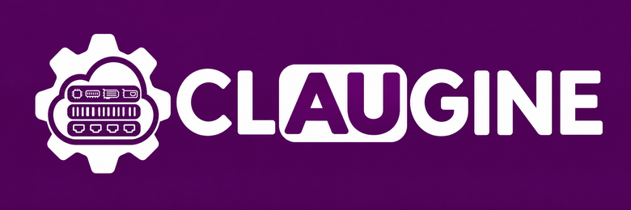

<p align="center"></p>

# Claugine

**CLoud AUtomation enGINE** — a portal to run an OpenNebula-based cloud for many customers: from an organization's
registration to its projects' networks, gateways and quotas on the platforms, and day-2 operations of the sites
themselves. Project site and documentation: [claugine.com](https://claugine.com) ·
[claugine.com/docs](https://claugine.com/docs/).

## What it does

- **Customers:** self-registration of organizations (e-mail confirmation, tax-ID check, checks against automated
  and suspicious registrations), staff approval, organization admins and members, invitations, join requests.
- **Projects:** ordering and approval, deployment on the OpenNebula platforms (group, quotas, users, networks), an
  edge gateway and an internet gateway (VyOS) per project with public subnets, BGP and shaping; changes after
  deployment (speed, subnets, size) as requests for approval; existing projects can be adopted from the platforms.
- **Infrastructure:** sites, platforms, clusters, networks and address registry, secrets (encrypted), router
  configuration templates, core services of a site (name servers, front ends, route reflectors, …), host health
  over IPMI/Redfish, timers that read the platforms and compare routers with their templates.
- **Staff:** roles (super admin, resource manager, support, sales), mandatory two-factor sign-in, audit log of every
  decision, daily reports.
- **The portal itself:** e-mail through its own relay (Postfix + DKIM) or an SMTP server, encrypted backups to a local
  folder, HAProxy with Let's Encrypt in front. The Enterprise edition adds a second site with database replication
  and switch-over, and backups to an S3 bucket.

The provider's name and logo are set in Settings → Provider ("Example Cloud" is only the default).

## Install

This repository holds the **installer** only. The portal's code of both editions comes as a release bundle from
[my.claugine.com](https://my.claugine.com) on your licence key; the installer verifies its checksum before unpacking
it, and updates arrive the same way. The documentation is at [claugine.com/docs](https://claugine.com/docs/).

**From green field** — start with portal/init on a VM on your laptop (Ubuntu 26.04, one NIC on the cloud-core
network, with routes to the servers' IPMI network). It installs the first site's hosts, its OpenNebula platform and
base services, then the production portal on that platform, moves its data there and locks itself:

```
mkdir -p ~/claugine && cd ~/claugine
curl -fsSLO https://raw.githubusercontent.com/ivladek/claugine/main/deploy/claugine-install.sh
bash claugine-install.sh --init --licence-key CLG-… --portal-name portal.example.com
```

**A portal on an existing platform** — on an Ubuntu 26.04 VM:

```
bash claugine-install.sh --new --licence-key CLG-… --site-url https://portal.example.com
```

A licence key comes from [my.claugine.com](https://my.claugine.com); see **Licences** below. Configuration lives in
`/etc/claugine-portal/`; management commands run as `sudo claugine-manage <command>`.

## Licences

[my.claugine.com](https://my.claugine.com) provides two licences:

- **Standard — free, with no time limit on use.** No payment, ever. The key is renewed every year at no cost, which
  keeps the installer, updates and restore coming; the portal itself never stops working, renewed or not.
- **Enterprise — commercial.** The Enterprise edition (two portal nodes on one or two sites, S3 backups, every
  update channel) with full support, for a fee.

## Licence

The installer in this repository is **source-available** under the [Business Source License 1.1](LICENSE). Running
it needs a licence key from [my.claugine.com](https://my.claugine.com); the Standard licence is **free of charge**
(see **Licences** above). The portal itself is delivered under the terms of your licence with each release bundle.

### Contributions

Outside contributions are not accepted at this time.
