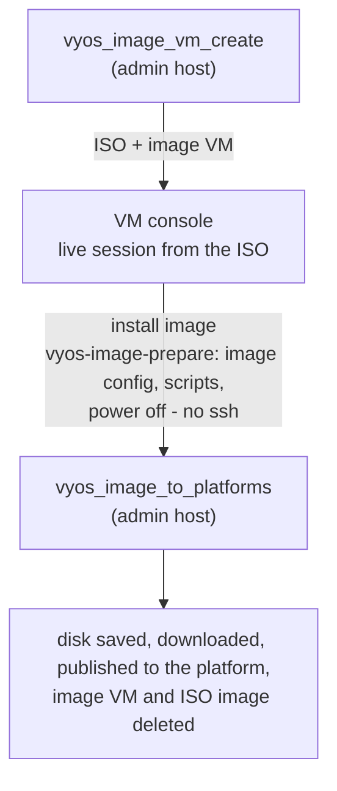

# VyOS image for OpenNebula

[Platform](../platform/README.md) › [Network](README.md) › VyOS image

This document describes how claugine builds a VyOS Stream router image
for OpenNebula and how VMs created from that image configure themselves.

- [Result](#result)
- [Prebuilt files](#prebuilt-files)
- [How it works](#how-it-works)
- [Before you start](#before-you-start)
- [Files](#files)
- [Phase 1: `vyos_image_vm_create`](#phase-1-vyos_image_vm_create)
- [Manual steps on the console](#manual-steps-on-the-console)
- [Phase 2: `vyos_image_to_platforms`](#phase-2-vyos_image_to_platforms)
- [VMs created from the image](#vms-created-from-the-image)
- [Publishing to another platform](#publishing-to-another-platform)
- [Existing images with the same name](#existing-images-with-the-same-name)
- [Cleanup](#cleanup)
- [Troubleshooting](#troubleshooting)

## Result

- An OS image `VyOS Router <version>` (qcow2) in the IMAGES datastore of the
  image VM's cluster on the image VM's platform; to other
  platforms - `image_upload`, see [Publishing](#publishing-to-another-platform).
- A local copy of the image, `vyos-<version>.qcow2`, in the local repository.
- A VM created from the image applies the OpenNebula context on its first boot:
  addresses, gateway, routes, MTU, host name, user, password, ssh key, time zone.

## Prebuilt files

The result of a build, ready to use without building, is on Google Drive -
the link is in [`binaries/README.md`](../../binaries/README.md). Download the
files into `binaries/`; git ignores them there.

| file | what | sha256 |
|---|---|---|
| `vyos-2026.03-generic-amd64-claugine.iso` | VyOS Stream 2026.03 ISO with the claugine scripts in `/claugine/` - the ISO of `vyos_image_vm_create` | `88321e6d346fa2e12bbb5c921919128fde4a98d9e98abbf09e896b674104b106` |
| `vyos-2026.03.qcow2` | the VyOS image `VyOS Router 2026.03` - the local copy of `vyos_image_to_platforms`, configured by `vyos-image-prepare` | `04f7c624940c59fef8366bbcfb522e5b98a6aa6c1c7433b3bd14ce8c1e3177b9` |

Check a downloaded file: `sha256sum binaries/<file>`. Put the image on a platform:

```bash
image_upload platform=platforms.dc1.payload1 file=binaries/vyos-2026.03.qcow2 name="VyOS Router 2026.03" type=OS
```

The image has user `vyos` with the default password of `config/data/vms.yaml`;
a VM created from it gets its user, password, key and network from the
context on the first boot - see [VMs created from the image](#vms-created-from-the-image).
A new VyOS release needs a new build: `jobs/create-vyos-image.sh`.

## How it works

VyOS publishes no cloud image for OpenNebula, and `install image` is
interactive. The build is split into two automated phases with three commands
on the VM console in between.



| Step | Where | Who | What happens |
|---|---|---|---|
| 1 | admin host | `vyos_image_vm_create` | download the latest VyOS Stream ISO, add the claugine files, upload the ISO, create the image VM |
| 2 | VM console | you | `install image`, then `vyos-image-prepare`: the image config built in the live session and saved to the installed disk, the scripts copied, VM powered off - the installed system never boots |
| 3 | admin host | `vyos_image_to_platforms` | save the disk as an image, download it, publish it to the image VM's platform, delete the image VM and the ISO image |

## Before you start

**Workstation** - the tools from `config/data/admin.yaml` (checked at start-up), in
particular `curl`, `xorriso`, `rsync`, `jq`, `ssh`.

**Data set** - the site of the image VM zone in the inventory:
`repos.zakroma.local_dir` - the local repository, the ISOs and the image go
to its `vyos/` subdirectory (created if missing). Images are copied from it
to the FE by rsync.

**Internal data** - the default password of the image: `password` of
`config/data/vms.yaml`; `config/data/vyos.yaml` - defaults, change only if
needed:

| Key | Default | Meaning |
|---|---|---|
| `url` | `https://vyos.net/get/stream/` | page with the latest Stream ISO link |
| `image_name` | `VyOS Router` | image name prefix, the version is appended |
| `vm.cpu`, `vm.ram` | `1`, `1` | image VM size, RAM in GiB |
| `vm.disk` | `2` | image VM disk, GiB - the size of the image |
| `vm.image` | `Empty disk` | image used for the image VM disk, resized to `vm.disk` |
| `vm.hostname` | `vyos` | host name of the image VM |
| `iso.dir`, `iso.files` | | files added to the ISO: directory in `config/files/`, list of `name` + `path`, see [Files](#files) |

**OpenNebula**

- the image VM platform in the inventory: `platform=platforms.<site>.<platform>`;
- an image named `vm.image` of `config/data/vyos.yaml` on the zone FE;
- a virtual network for the image VM with a free address - a VM needs a NIC,
  the build does not use it: **no ssh to the image VM** in any phase;
- `SSH_PUB` - the public key of `${SSH_KEYF}`, made by claugine when it loads;
  `vm_create` requires a key, it goes into the image VM context and is not used.

## Files

All files live in `config/files/vyos/`. `iso_get_vyos` adds them to the ISO under
`/claugine/`; in the live session the ISO is mounted at
`/usr/lib/live/mount/medium`.

| File | Runs | Purpose |
|---|---|---|
| `vyos-image-prepare` | manually, live session, VM console | builds the image config: `VYOS_INITITAL_CONFIG` applied to the live session in one config session - the password hash of `CRYPTED_PASSWORD_BASE64` of the context; saved by VyOS and copied to the installed disk as `/config/config.boot`; copies the scripts below, powers off; the grub of the installer is kept. To change the image defaults, edit `VYOS_INITITAL_CONFIG` and build a new ISO |
| `vyos-postconfig-bootup.script` | every boot (VyOS standard hook) | mounts the context CD (label `CONTEXT`); applies the context variables on the first boot (no flag `/opt/vyatta/etc/init.flag`) or with `VYOS_CONFIG_REAPPLY=YES`; runs the custom context scripts on the first boot or with `CONTEXT_SCRIPTS_ENFORCE=YES`; creates the flag and reboots after the first run |

On the installed system the scripts are in `/config/scripts/`
(`/opt/vyatta/etc/config/scripts/`).

## Phase 1: `vyos_image_vm_create`

```bash
source bin/claugine
vyos_image_vm_create platform=platforms.dc1.mgmt cluster=default vnet=core_dc1 gw=10.71.101.254   # addr=auto: a free IP of the VNet
```

| Parameter | Meaning |
|---|---|
| `platform=NAME` | platform where the image VM runs, `platforms.<site>.<platform>` |
| `cluster=ID\|NAME` | cluster of the image VM, default `0`; `vm.image` of `config/data/vyos.yaml` and `vnet` must belong to it; the ISO goes to the IMAGES datastore of the cluster |
| `vnet=STRING` | image VM network, name or id |
| `addr=IP\|auto` | image VM address, default `auto` - a free IP leased from the VNet, logged as `vm_ip=`; not used by the build |
| `gw=IP` | optional: gateway of the image VM |
| `result=VAR` | variable of the caller: gets the image VM name `VyOS Router <version>` |

What it does:

1. `iso_get_vyos` finds the latest Stream ISO, downloads it to the local repository
   (cached, partial downloads resumed) and builds
   `vyos-<version>-generic-amd64-claugine.iso` - the name of the downloaded
   file with `-claugine` - with the files from
   `config/files/vyos/` in `/claugine/`. The ISO stays bootable.
2. Stops if the image VM `VyOS Router <version>` already exists - the image
   VM is named as the image it makes: `image_name` and the version.
3. Uploads the ISO as CDROM image `VyOS Router <version> ISO`.
   An existing image with this name is handled as described in
   [Existing images](#existing-images-with-the-same-name).
4. Creates the image VM `VyOS Router <version>` in `cluster`: 1 CPU, 1 GB RAM,
   disk 0 - `vm.image` resized to `vm.disk` GiB (`config/data/vyos.yaml`), disk 1 -
   the ISO, boot order ISO first, NIC with `addr`, user `vyos` with the
   default password and your public key in the context, no hourly autostart.
5. Returns the image VM name in the caller variable of `result=VAR` - the
   default name of the image of `vyos_image_to_platforms`.

## Manual steps on the console

Open the VM console in FireEdge (VNC):

1. Log in as `vyos` / `vyos` (live session defaults).
2. Run `install image` and accept the defaults; answer **no** to the reboot
   question.
3. Run
   ```
   sudo bash /usr/lib/live/mount/medium/claugine/vyos-image-prepare
   ```
   Run it on the VM console: it changes the config of the live session, its
   network goes down. It
   - finds the installed system (partition labeled `persistence`);
   - reads the password hash from `CRYPTED_PASSWORD_BASE64` of the context CD
     (label `CONTEXT`) - the default password of `config/data/vms.yaml`, put
     there by `vm_create`;
   - applies `VYOS_INITITAL_CONFIG` to the live session in one config session,
     as `vyos-postconfig-bootup.script` does - by default it deletes `interfaces
     ethernet`, `protocols static`, `service` and the ssh keys of user `vyos`;
     sets the default password, host name `vyos-router`, ssh on port 22,
     `ctrl-alt-delete ignore`, `reboot-on-panic`;
   - copies the config saved by VyOS to the installed disk,
     `/config/config.boot` - the syntax and the version line are VyOS's own;
   - copies `vyos-postconfig-bootup.script` to `/config/scripts/`;
   - powers the VM off after 10 seconds.

   The installed system never boots during the build: no ssh host keys,
   `machine-id` or shell history to clean up - a VM created from the image
   makes its own on the first boot.

The grub of the installer is kept as VyOS writes it (VyOS 1.5, Stream
2026.03): `grub.cfg` loads `grub.cfg.d/` - the image versions, the default
image, the console type and the kernel options of the config. So the
standard VyOS behavior stays: `add system image`, `set system image
default-boot`, `set system option kernel ...`, `set system console` and the
password recovery entry of the boot menu work. At `install image` keep the
default console - KVM (`tty0`), the VNC console of OpenNebula.

## Phase 2: `vyos_image_to_platforms`

Run it when the image VM is in state POWEROFF - powered off by `vyos-image-prepare`:

```bash
vyos_image_to_platforms platform=platforms.dc1.mgmt vm="VyOS Router 2026.03"
```

| Parameter | Meaning |
|---|---|
| `platform=NAME` | platform of the image VM |
| `vm=STRING` | image VM name or id - in state POWEROFF, after `vyos-image-prepare` |
| `confirm=yes` | skip the confirmation |

The image is named as the image VM, `VyOS Router <version>`, and goes to the IMAGES datastore of the image VM's cluster.

What it does:

No ssh to the image VM: the command only saves the disk.

1. Saves the VM disk as a temporary image and waits until it is READY - the ISO stays attached.
2. Downloads it to `<directory>/vyos-<version>.qcow2`.
3. Uploads it with `image_upload` to the image VM's platform as OS image
   `VyOS Router <version>` - copied to the FE by rsync.
4. Deletes the temporary image, the image VM and then the ISO image `VyOS Router <version> ISO` of the build.

## Both phases in one run: `vyos_image_create`

```bash
vyos_image_create platform=platforms.dc1.mgmt cluster=0 vnet=core_dc1 result=image   # addr=auto, limit=600
```

`vyos_image_vm_create`, then it waits up to `limit` seconds (default 600) for the image VM to be
powered off - do the [manual steps on the console](#manual-steps-on-the-console) meanwhile -
then `vyos_image_to_platforms`. `result=` gets the image name. On timeout the image VM stays:
run `vyos_image_to_platforms` by hand when it is powered off. `jobs/create-vyos-image.sh` uses it.

## VMs created from the image

`vyos-postconfig-bootup.script` applies the OpenNebula context on the first
boot - no flag `/opt/vyatta/etc/init.flag` - and on the next boots only with
`VYOS_CONFIG_REAPPLY=YES`. All ethernet interfaces and static routes are
deleted before and set from the context:

| Context variable | Default | Effect |
|---|---|---|
| `ETHn_MAC` | | the interface `ethN` is configured only if present |
| `ETHn_IP`, `ETHn_MASK` | mask `255.255.255.0` | interface address |
| `ETHn_GATEWAY` | | default route via this gateway |
| `ETHn_ROUTES` | | `NET via GW, NET via GW` - static routes |
| `ETHn_METRIC` | `100` | distance of the routes of this interface |
| `ETHn_MTU` | `1500` | MTU; IPv6 link-local and forwarding disabled |
| `SET_HOSTNAME` | `vyos-router` | host name |
| `USERNAME` | `vyos` | the user; another name disables `vyos`, `vyos` enables it again; a user of a former `USERNAME` stays |
| `CRYPTED_PASSWORD_BASE64` | the password of the image | base64 of the password hash, changed for `USERNAME`; without it the password is kept - `password` of `config/data/vms.yaml` |
| `SSH_PUBLIC_KEY` | | key of the user; with it ssh password authentication is disabled, without it allowed |
| `SSH_PORT` | `22` | ssh port, all interfaces - a listen address is removed |
| `TIMEZONE` | `Asia/Almaty` | time zone |
| `VYOS_CONFIG_REAPPLY` | `NO` | `YES` - apply the context on every boot, not only the first |
| `CONTEXT_SCRIPTS_ENFORCE` | `NO` | `YES` - run the custom context scripts on every boot, not only the first |

Custom context scripts - every `*.sh` on the context CD except `context.sh`,
in alphabetical order, as group `vyattacfg` - run on the first boot and on
the next boots only with `CONTEXT_SCRIPTS_ENFORCE=YES`.

After the first run the VM reboots once - the routing engine starts only
after a reboot; the flag file holds the initialization date. A reapply does
not reboot: the commit applies it. To move a router to a new address of
OpenNebula: change the NIC, set `VYOS_CONFIG_REAPPLY=YES` in the context,
reboot; then remove it, or keep it to keep the context the source of truth.

> The default password (`password` of `config/data/vms.yaml`) is published with claugine.
> Always set `SSH_PUBLIC_KEY` or `CRYPTED_PASSWORD_BASE64` in the VM template.

`vm_create` fills these variables from its parameters (`vnetN`, `addrN`,
`gwN`, `routesN`, `metricN`, `mtuN`, `hostname`, `user`, `pswd`, `key`, `tz`).

## Publishing to another platform

To put the same image into other platforms, publish the local copy - no
second image VM is needed:

```bash
for p in platforms.dc2.payload1 platforms.dc1.payload2
do
  image_upload platform=${p} \
    file=/srv/claugine/repo/zakroma/vyos/vyos-2026.03.qcow2 name="VyOS Router 2026.03" \
    type=OS                                         # copied to the FE by rsync
done
```

`vyos_image_to_platforms` publishes to the image VM's platform only.

## Existing images with the same name

`image_upload` frees the name before it creates a new image (`image_archive`):

- the image is used by no VM - it is deleted, and the upload waits until it
  is gone;
- the image is used by VMs - it is renamed to `NAME (YYYY-MM-DD)`, the date of
  its registration (`NAME (YYYY-MM-DD HH-MM)` if that name is taken too).

VM templates that refer to the image by ID lose it when it is deleted;
templates that refer to it by name get the new image.

## Cleanup

`vyos_image_to_platforms` leaves for you to decide:

- the image VM `VyOS Router <version>`, powered off - terminate it;
- the ISO image `VyOS Router <version> ISO` on the zone FE;
- in the local repository: the original ISO, the customized ISO and
  `vyos-<version>.qcow2`.

## Troubleshooting

Both commands return `1` on any error; the message names the step. The
messages and what to do:

| Step | Message | What to do |
|---|---|---|
| build | platform not in the inventory, FE not reachable | check the inventory and the VIP |
| build | `vnet` not set | pass it |
| build | ISO not found, not downloaded or not customized | check the download site and `config/data/vyos.yaml` |
| build | image VM already exists | terminate it, or finish it with phase 2 |
| build | ISO upload failed, VM creation failed | cluster, image or network not found or not unique, address leased |
| finalize | image VM not found | check `vm=` |
| finalize | VM not powered off | finish the manual steps first |
| finalize | VM not powered off, disk not saved | check the VM in OpenNebula |
| console | `vyos-image-prepare` stops with an error | the message names the step: no `persistence` partition (run `install image`), no context CD or `CRYPTED_PASSWORD_BASE64`, a command of `VYOS_INITITAL_CONFIG` rejected |
| finalize | disk not saved, image download failed | check the datastore and the local repository |
| finalize | upload failed | the image is in the local repository - rerun `image_upload` |

Test scripts: `tests/vyos-image-build.sh` and
`tests/vyos-image-finalize.sh "VyOS Router <version>"`, data in
`tests-data.sh` of the data set.
